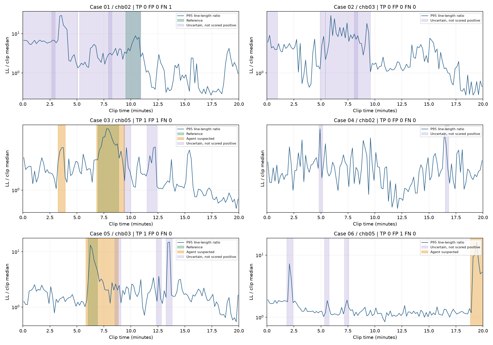

# 多患者20分钟EEG预演：结果与当前问题

本轮输入为3名患者的6段公开脑电，每段1200秒，共2小时。每人一段含发作区域和一段背景区域，按公开标注定向选取；不是随机盲测或完整EEGAgentBench评测。

## 最终结果

六例完成6/6；严格疑似结果：TP=2、FP=2、FN=1；事件F1=0.571；按本组时长归一化FP/小时=1.000；阳性片段平均Dice-S=0.397。

仍有18条不确定候选。把疑似和不确定全部放入人工复核队列时，事件TP/FP/FN=3/11/0。不确定没有作为严格阳性计分，因此不能只看严格FP数量就认为人工复核负担已经下降。



绿色为参考，橙色为严格疑似，紫色为不确定。横轴为片段内分钟；蓝线是线长相对自身背景的变化量，不是模型概率。各图纵轴尺度不同。

|案例|患者|参考区间/片段秒|严格疑似区间/片段秒|TP/FP/FN|不确定候选数|
|---|---|---|---|---|---|
|01|chb02|[[572.0, 653.0]]|[]|0/0/1|4|
|02|chb03|[]|[]|0/0/0|4|
|03|chb05|[[417.0, 532.0]]|[(195.0, 235.0), (410.0, 565.0)]|1/1/0|2|
|04|chb02|[]|[]|0/0/0|2|
|05|chb03|[[362.0, 414.0]]|[(350.0, 530.0)]|1/0/0|3|
|06|chb05|[]|[(1130.0, 1200.0)]|0/1/0|3|

时间从各片段起点计，不是原始EDF时间。事件匹配采用冻结评分代码的起点30秒、终点60秒等容差及事件合并规则；事件命中不代表起止边界精确，需结合Dice和区间图。

## 候选与证据对应

本轮共保留22条候选，包含保留、排除及不确定的全部决定。每条都有时域、频谱、跨通道证据ID，以及候选前/中/后的局部测量。

说明字段与证据编号独立；已修复schema对象共享导致的enum污染，并加入回归检查。正确编号只能证明引用来源对应，不能证明模型解释正确。

|案例|候选|决定|三类证据与原始数值|
|---|---|---|---|
|01|C1|uncertain|[证据卡](results/final/case_01/C1_证据卡.md)|
|01|C2|uncertain|[证据卡](results/final/case_01/C2_证据卡.md)|
|01|C3|uncertain|[证据卡](results/final/case_01/C3_证据卡.md)|
|01|C4|uncertain|[证据卡](results/final/case_01/C4_证据卡.md)|
|02|C1|uncertain|[证据卡](results/final/case_02/C1_证据卡.md)|
|02|C2|uncertain|[证据卡](results/final/case_02/C2_证据卡.md)|
|02|C3|uncertain|[证据卡](results/final/case_02/C3_证据卡.md)|
|02|C4|uncertain|[证据卡](results/final/case_02/C4_证据卡.md)|
|03|C1|suspected|[证据卡](results/final/case_03/C1_证据卡.md)|
|03|C2|suspected|[证据卡](results/final/case_03/C2_证据卡.md)|
|03|C3|uncertain|[证据卡](results/final/case_03/C3_证据卡.md)|
|03|C4|uncertain|[证据卡](results/final/case_03/C4_证据卡.md)|
|04|C1|uncertain|[证据卡](results/final/case_04/C1_证据卡.md)|
|04|C2|uncertain|[证据卡](results/final/case_04/C2_证据卡.md)|
|05|C1|suspected|[证据卡](results/final/case_05/C1_证据卡.md)|
|05|C2|uncertain|[证据卡](results/final/case_05/C2_证据卡.md)|
|05|C3|uncertain|[证据卡](results/final/case_05/C3_证据卡.md)|
|05|C4|uncertain|[证据卡](results/final/case_05/C4_证据卡.md)|
|06|C1|uncertain|[证据卡](results/final/case_06/C1_证据卡.md)|
|06|C2|uncertain|[证据卡](results/final/case_06/C2_证据卡.md)|
|06|C3|uncertain|[证据卡](results/final/case_06/C3_证据卡.md)|
|06|C4|suspected|[证据卡](results/final/case_06/C4_证据卡.md)|

## 本次观察与下一步

完整候选阶段覆盖参考事件3/3；这一数字是事后核对，不进入Agent。
严格疑似仍有漏检，位于案例01。优先检查其候选是否已被扫描覆盖，再区分模型判断、数值门槛及边界定位的问题；不能直接通过放宽阈值宣称解决漏检。
仍有误报，位于案例03, 06。下一步检查背景活动与伪迹解释、共享电极相关性，以及片段边缘是否缺少前后背景。
先让模型逐个指出哪些5秒窗支持结论，再收束边界；数值变化只作为测量支持，不能充当发作真值。需要使用新的固定患者/片段做独立核对，才能评价后续策略是否泛化。

## 工具与资源

```json
{
  "model_calls": 68,
  "tool_dispatches": 34,
  "measurements_executed": 28,
  "cache_hits": 0,
  "invalid_calls": 0,
  "submission_rejections": 0
}
```
model_calls是模型生成次数；tool_dispatches含候选登记；measurements_executed是整段扫描及局部测量调用次数，局部一次返回三类证据。cache_hits为实际重复测量缓存命中数；缓存机制通过预检，不代表本次实际节省了某个百分比算力。

推理使用Qwen3-8B、AMD R9700。完成路径累计分析654.5秒；冷加载累计155.2秒；峰值torch分配16.99GiB。若有第二次边界复核加载，以上已经合并，不包含早期调试轮、下载、部署与空闲计时。

## 结果可信范围

只展示修复字段隔离后的fixed/final。早期main、guarded、refined调试轮存在schema错误，保留在AUP及工作目录，不能用其分数比较模型能力或宣称误报从某个数值下降。本轮没有做正式baseline比较。

fixed阶段TP/FP/FN=2/2/1；追加一次受限局部复核后的final=2/2/1。这是同一开发样本上的处理过程，不是独立测试。

具体的数值混用、方向错误、共享电极误读和下一轮设计见[证据审阅与改进规划.md](证据审阅与改进规划.md)。模型自由文字尚未通过逐项事实认证。

课堂发言稿见[课堂发言稿.md](课堂发言稿.md)，实际回放入口为[demo_v2.ipynb](demo_v2.ipynb)。完整结课报告及GitHub发布按用户安排后续处理。